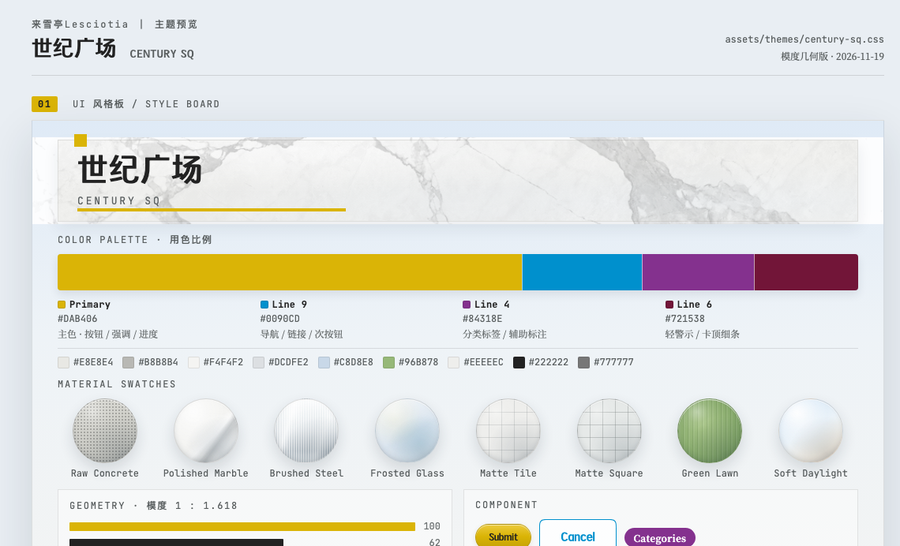
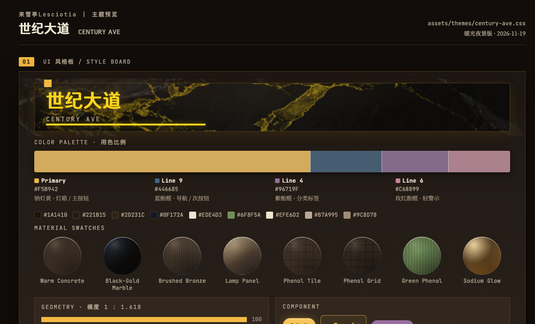
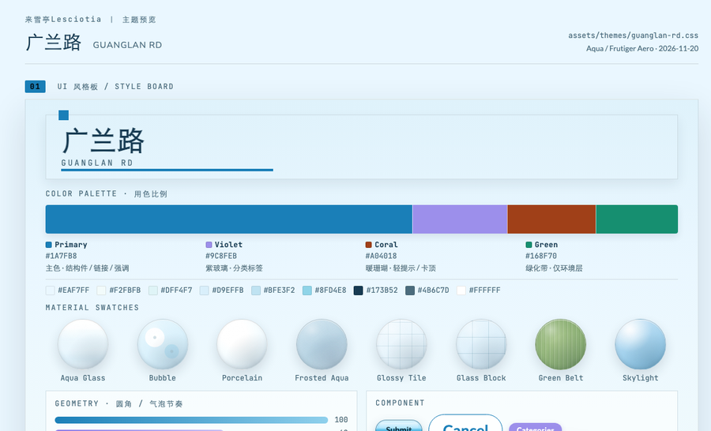
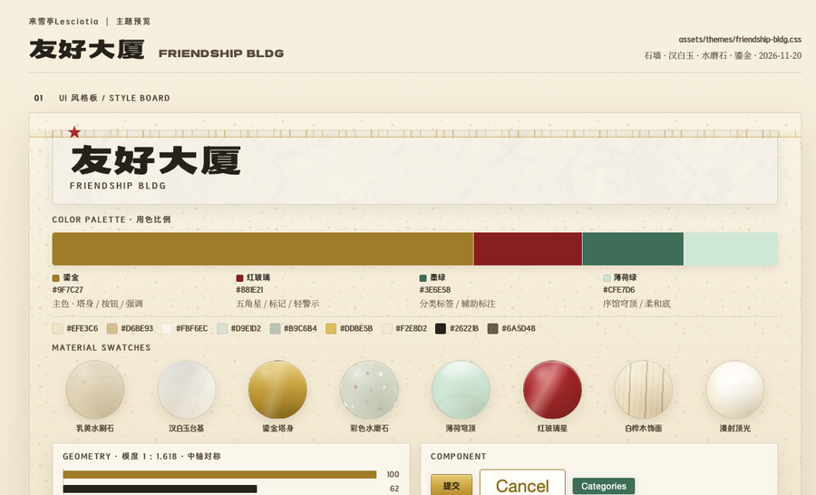
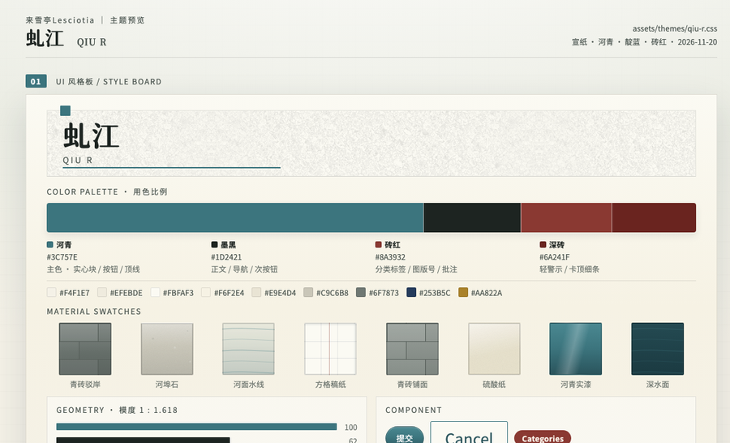
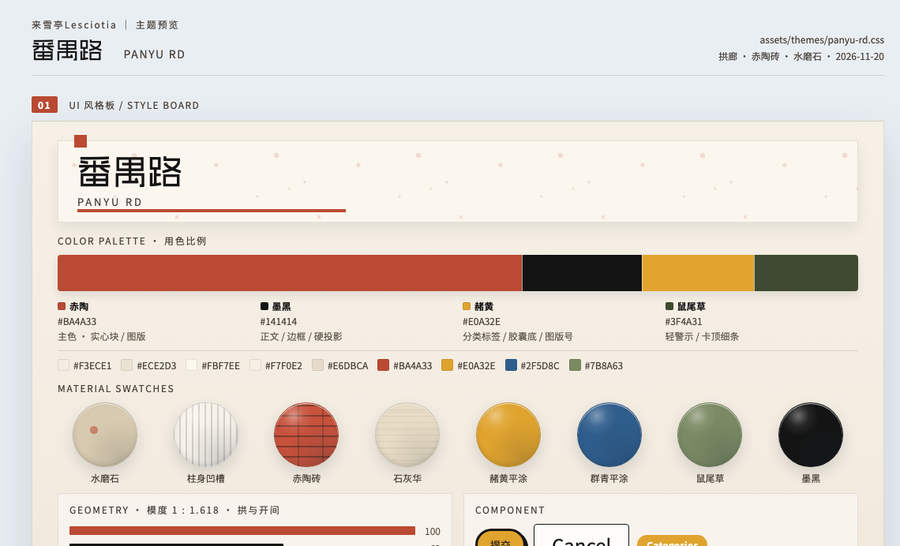
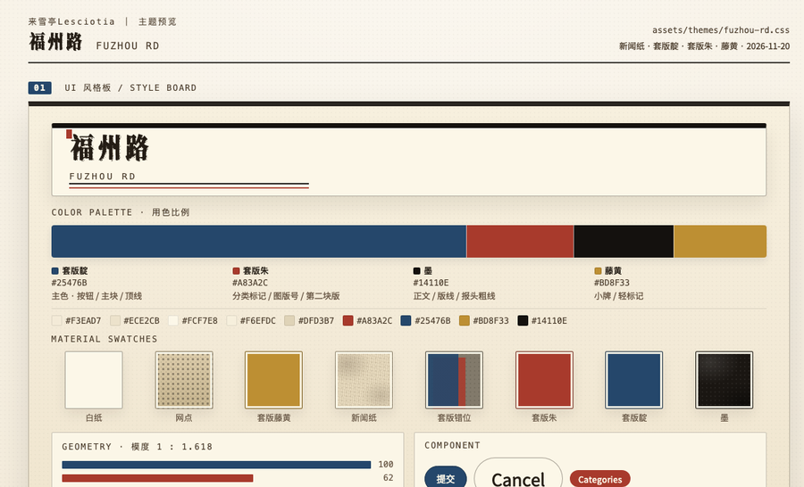
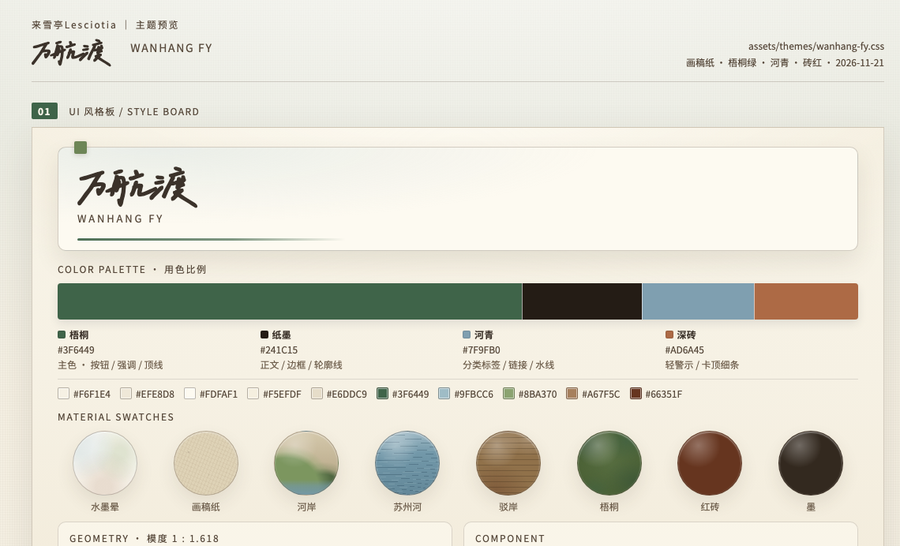
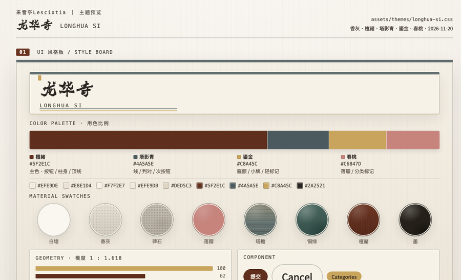

# 来雪亭 Lesciotia

[English](README.en.md) · 中文


> 罗浮山下雪来未？
>
> 江中有亭，此亭待雪。
> 你飞来一场初雪，洋洋洒洒，
> 而梁架先立，瓦色后施，
> 料落其间，遂成一篇。

「罗浮山下雪来未」出文天祥《北归宿中川寺》；一九六四年郭沫若取此诗意题「来雪亭」横额。拉丁名 `Lesciotia` 是音骨架，只作检索锚，不拆字义。

一份讲稿，三种能拿到手的东西：

- **网页件**：一个 `.html`，双击就开，键盘翻页，讲稿跟着走。
- **可改件**：一个 `.pptx`，文字是真文本、图是真图，甲方在 PowerPoint 里自己改字。
- **影像件**：一堆逐页 PNG 再合成 pptx / pdf，要 100% 像、且今后不再改时用。

三件是同一份内容的三种壳，不是三个 skill；选哪个、代价在哪，见下节「三种壳」。

17 族梁架（39 式）、9 种瓦作、5 套整册，全部离线可跑。瓦作各取一个上海真实地点——路、广场、河道、楼、寺都算（『友好大厦』取中苏友好大厦的意象）；走一趟那里，看到的就是一套配色与材质。网页件只用 Python 3 标准库；可改件多一个 `python-pptx`。

名字取自温州江心屿的「来雪亭」——亭在孤屿东北角，北望罗浮山。读音以 `SKILL.md` §读音钉死 为准。

## 三层词汇

名字里的「亭」和「雪」各管一层：

| 词 | 管什么 | 目录 | 数量 |
|---|---|---|---|
| **梁架** | 骨架：信息怎么排、几栏、什么顺序 | `assets/layouts/` | 17 族 / 39 式 |
| **瓦作** | 表面：配色、字体、材质 | `assets/themes/` | 9 |
| **落雪** | 用户投进来的原始素材 | 无（输入侧） | — |

雪落在瓦上，不落在梁架上——所以「雪」归瓦作这一层，而用户带来的料叫**落雪**。
三个词只是称呼，目录名不改。详见 [`SKILL.md`](SKILL.md) §三层词汇。

## 三种壳：拿到手的是什么、代价在哪

「出口」是问「最后长成什么文件」，不是三个独立工具。同一份 `pages/NN.md` 和同一套瓦作，按你要做的事选一件：

| 拿它干什么 | 选哪个 | 你收到什么 | 收件人能做什么 | 做不到的（失效边界） |
|---|---|---|---|---|
| 讲给人听：分享、内训、发布会 | **网页件** | 单个 `.html`，几 MB，断网能开 | 按方向键翻页、按 S 开演讲者视图（当前页/下一页/逐字稿/计时） | 对方不能改字；导成 pptx 只是贴图 |
| 交给要改字的人 | **可改件** | 原生 `.pptx` | 在 PowerPoint 里改文字、换图、挪形状 | 圆角按 `--radius` 同值裁成（图仍是可换的原图）；图片取景裁切、动效与网页件不完全等同；渐变是换算后的近似 |
| 要求 100% 像，且今后不动 | **影像件** | 逐页 PNG → pptx / pdf | 只能整页换图 | 一个标点也改不了；改字要重出图 |

**常见错误**：① 把网页件当可改件发出去，对方要动一个字也得回来找你；② 以为可改件与网页件像素全同——它们是同一套瓦作的两个渲染器，不是同一张截图（`SELFTEST.md` §1.2.59 记的就是这条：同一个图组页，两边摆法最初不一致，甲方以为是两版稿）；③ 拿影像件应急，事后又要改内容，只能整页重出图。

**怎么记**：A＝影像件，B＝网页件，C＝可改件。字母只在命令行与脚本里用，文档与对话里说功能名。

**册级导航条**：长册（20 页以上、分节讲）才需要「现在讲到哪一节」。在讲稿首部写一行 `<!-- nav: 序 > 现状 > 判断 > 出册 -->`，每页再写 `<!-- sec: 现状 -->`，两件同时长出同一条导航条：当前节用 accent 加下划线（文字型），或整条通栏底 + 当前节实块（`<!-- nav-block: … -->`）。只放顶部；左侧要重排版心、底部与页脚抢行，都不做。


**四式反哺（1.2.66）**：从外部参考里只取机制，不取配色与图标——**图带压卡**（`.ride`：全幅图带，结论行压带内，两张白卡骑压带下沿）、**左文右图出血**（`.split.bleed-img`：图栏推到页边）、**底线三段卡**（`.cols3`：段间虚线、卡底一道 accent）、**胶囊 chips**（`.chips`：标签分组，末位可放省略丸）。前两者是影像族与分栏族的参数，后两者是三列卡与组件，17 族 39 式不变。md 里分别写 `<!-- layout: ride -->`、`<!-- layout: bleed -->`、`<!-- layout: cols3 -->`（可加 `<!-- chips: A｜B｜C -->`），C 出口降级为列表/单图页并逐页打印降级说明。

1.2.71 修比例条的可读性：标签从轨道内移到左列，轨道只留色段；顺手把全库品牌色实心块扫了一遍，广兰路 `.tag-chip`（白压紫玻璃 2.78:1）与 `.cp-anchor`（白压主蓝 4.40:1）都改回 `--accent-ink`，`check-theme-colors.py` 增加组件层字色扫描，同类写法以后直接 FAIL。

1.2.70 又补两件：`<!-- layout: bars -->`（横条比例，轨道内嵌标签、数值钉右端、表后一段作注脚）、`<!-- layout: team -->`（团队卡，人像切进错位的有机形状，无图退成同形淡色块）。取的是第四批参考里的人像底衬与百分比条，不取配色、不取图标条——库里没有图标体系。C 侧分别降为两列表格与列表页。

1.2.69 补上参考图里最显眼的「弧形分割」与「弧线时间轴」，外加一条底部口号带：`<!-- layout: arc -->`（S 弧分界、图通到页边）、`<!-- layout: timeline-arc -->`（里程碑沿贝塞尔曲线排、日期竖杆交替上下）、`<!-- band: 一句话 -->`（通栏口号带）。C 侧分别降为单图页与列表页。

1.2.68 再加两式与质感三件：甘特 `<!-- layout: gantt -->`（表头 `任务|模块|起|止|完成`，日期算刻度、跨年分带、条内嵌完成度、模块虚线分组）；模块格 `<!-- layout: modules -->`（最多四张卡＋一图占末格）。质感件是 `.soft-cast`（光影替边框）、`.glass-pane`（玻璃面）、`.bubble`（气泡），只挂 theme token，不改九瓦作既有玻璃。

## 九种瓦作：一个地名，一套配色

九个名字都对着上海真实的路、广场、河道、楼与寺（不全是地铁站名，有的地名恰好也是站名；『友好大厦』取中苏友好大厦的意象）；到那儿走一遍，看到的就是这套配色与材质的由来。九张切片都从对应预览板截出（`python3 scripts/gen-theme-slices.py` 一条命令重出），完整预览板在 `examples/previews/<slug>-theme-preview.html`。

<table>
<tr>
<td width="33%"><br><b>世纪广场</b> Century Sq<br>标线黄压清水混凝土，模度 1:1.618</td>
<td width="33%"><br><b>世纪大道</b> Century Ave<br>同族暗色版：钠灯暖光、酚醛板</td>
<td width="33%"><br><b>广兰路</b> Guanglan Rd<br>Aqua 玻璃、青蓝高光、胶囊圆角</td>
</tr>
<tr>
<td><br><b>友好大厦</b> Friendship Bldg<br>乳黄水刷石、鎏金、白桦木</td>
<td><br><b>虬江</b> Qiu R<br>宣纸、河青、靛蓝细线、砖红图版号</td>
<td><br><b>番禺路</b> Panyu Rd<br>拱券与柱身凹槽，排印走新粗野主义</td>
</tr>
<tr>
<td><br><b>福州路</b> Fuzhou Rd<br>新闻纸、套版靛、套版朱、45° 网点</td>
<td><br><b>万航渡</b> Wanhang Ferry<br>画稿纸、梧桐绿、水墨晕、河岸</td>
<td><br><b>龙华寺</b> Longhua Si<br>香灰、塔檐、白墙，鎏金只走线</td>
</tr>
</table>

**灵感来处**（瓦作里的 hex 是按意象调的，不是从照片取样；只当取意的线索看）：

- **世纪广场**：上海交通标线的那道黄，压在清水混凝土与大理石上；广场铺装正是这个调子，所以它成了主色。栏宽、色块与间距按柯布西耶模度 1:1.618 收放，所以版式换页也同比例；材质只用大理石、拉丝钢、磨砂面。
- **世纪大道**：同一个族的暗色版——高压钠灯的暖光打在酚醛板上，深底白字，适合晚上放的稿。
- **广兰路**：千禧年前后的 Aqua 玻璃界面，青蓝高光、胶囊圆角、细白描边；讲技术、讲产品时用它，不显旧也不喧宾夺主。
- **友好大厦**：1955 年的中苏友好大厦（今上海展览中心），乳黄水刷石墙面、汉白玉柱、鎏金塔尖、白桦木饰面，加一点苏式彩绘记号。
- **虬江**：五角场河道两岸的校园气——宣纸底、河青实心、靛蓝细线，砖红只做图版号；配方格稿纸、河面波线、河埠石。
- **番禺路**：番禺路 60 号孙科别墅（1931，邬达克）的拱券外轮廓、柱身凹槽、水磨石颗粒；排印反着来，走新粗野主义：3px 墨黑框、4px 实心硬投影。
- **福州路**：旧称四马路，报馆街与书店街——新闻纸底、套版靛主色、套版朱标记、藤黄小牌，母题是 45° 网点、套印错位、栏线与报头双线；渐变必须有印刷来由（网目过渡、油墨与纸的衰老）。
- **万航渡**：万航渡路 4830 米，1864 年极司菲尔路一路改名至今；加上路 618 号美术电影制片厂旧址的手工气——画稿纸、梧桐绿、河青细线，水墨晕、驳岸与拷贝纸纤维；标题用喜脉体。
- **龙华寺**：龙华塔 977 年，八角七级砖木楼阁式——香灰底、白墙、檀赭主色、塔影青；鎏金只做线与小匾，春桃只做落瓣，不做大面积彩。

九张切片只截板头、色板与材质样片；字体授权提示条不截（那不是风格，是免责声明）。

**地名与年份已经逐条核对过**：世纪广场在世纪大道 2100 号（上海科技馆站旁）；中苏友好大厦 1954 年动工、1955 年建成，1968 年改上海展览馆、1984 年定名上海展览中心；孙科别墅在番禺路 60 号，1931 年建成，邬达克设计；龙华塔 977 年（太平兴国二年）重建，七层八角，砖心木檐；万航渡路全长 4830 米，1864 年筑极司非尔路，1943 年改梵皇渡路，1964 年谐音定今名。

## 技术路线：瓦作先验

同类的 HTML→PPTX 工具走的是同一条路——用 headless 浏览器把页面渲一遍，再抓 DOM 与
computed style，映射成原生形状。代表是 `slidesmith`、`GX-Alex/html2pptx`、
`dom-to-pptx`、`html-native-pptx`、`mmoollee101-lab/HTMLtoPPTX`。这条路能拿到真实数值，
代价是**真源在渲染那一刻**：换主题要整页重算，同一份 HTML 两次导出未必一致，
抓不到的东西（复杂渐变、布尔形状、动效）只能退回整页截图。

来雪亭反过来做：瓦作是**先验**的——`--hex` token 与一套 1600×900 栅格存在文件里，
网页件与可改件从同一份 `:root` 各自出件，字体用同一批随包文件
量宽、把换行点写死。目标只有一个：换一遍瓦作，两边一起变。截图级的相似不在目标里。

可复核的三条：

- 换主题只改 `:root`，HTML 与 PPTX 同步变；脚本里没有第二份配色表。
- 版心、栏宽、字号来自同一组数：页边距、`--radius` 18px、`.h2` 的 54/68px 都从 CSS 读，
  两处读数同源，不靠目测比对（标题字号现由 `--deck-css` / 主题 CSS 的 `h2` 规则决定）。
- 收件人机器缺字体时，行不重排：断行按 HTML 侧字面的真实字宽锁成硬段，只有字形不同。

## 两个可选件（不装也能出整册）

- **页面骨架 `.sk12`**：12 列网格（`l1`–`l12` 与 `full`），给「一页里几块东西怎么排」一个可数的格。
  族页决定「这一页是什么」，骨架只决定「这一页里东西放哪」，⛔ 别拿它替代族页。
- **玻璃透镜 `assets/effects/lens.js`**：圆角矩形 SDF → 正弦剖面 → Snell 偏折 → RGB 三通道色散，
  只在棱带弯折、中心零位移；读不到像素（`file://` 直开）自动落回 SVG 湍流兜底并标角标。
  机制、参数与实测见 [`references/effects-lens.md`](references/effects-lens.md)。

## 染层字段：`fill` 与 `boolean`

渐变与布尔不进 PPT 的「形状库」，它们是**导出时的求值**——瓦作里写 CSS 声明，
`wash_bridge.py` 翻译一次，浏览器另一处解释同一份声明。spec 里这样写：

```json
{"type":"wash","title":["渐变与布尔"],"color":"#FFFFFF",
 "shapes":[
  {"shape":"rect","box":[0,0,1600,900],"fill":{"gradient":"linear-gradient(135deg, #0E1622 0%, var(--line-2) 45%, rgba(214,166,58,.75) 100%)"}},
  {"shape":"circle","center":[1360,760],"r":420,"fill":{"gradient":"radial-gradient(circle at 30% 30%, rgba(255,255,255,.55) 0%, rgba(255,255,255,0) 70%)"}}
 ]}
```

- `fill`：`{"gradient": "…"}`（多色标、角度/`to side`、rgba 的 alpha）或 `{"solid": "--token" | "#RRGGBB", "alpha": 0.4}`。
- `boolean`：`{"op":"subtract"|"intersect","a":…,"b":…}` → 出 `a:custGeom`。操作数三种写法：
  `{"center":[x,y],"r":n}`（两圆走解析解，边界最干净）、`{"path":"M…A…Z"}`、`{"points":[[x,y],…]}`。
  后两种折算成折线，走 `poly_bool` 的「切段 + 分类 + 接力」，**能出多轮廓**（挖洞、咬成几块都行）。
  自交折线直接拒：它的「内部」本身没有定义。**并集不做**：同色叠两张。
  两形**共享一段边**时按「内部在这条边的同侧还是异侧」分类：同侧→交集留、差集丢；异侧→反过来。
  判同侧靠沿法线两侧各探一次（同侧说明这块面积对两个形都算「里」）。两份重叠段只留 A 那一份——
  都留就成了双线，接力接不上。两形边界完全重合时，交集返回 A、差集报空。
- `path`：`clip-path: path()` 里的那串 `d` 原样进，**默认按曲线出**——`A` 每段拆到 ≤90° 再换成
  三次贝塞尔（`k = 4/3·tan(θ/4)`）、`Q` 升阶、`C` 直写 `a:cubicBezTo`；写了 `"curve":"polyline"`
  才退回采样折线。布尔的结果仍是折线：曲线对曲线的**真裁剪**要 `skia-pathops`，与本库零重依赖
  的路线冲突，不引。
- 任何页都可以带 `wash` 层：它在 `slide()` 里先落下，内容压在上面。

三处踩过的坑都写进代码注释了：`p:style` 会给形状挂主题投影（瓦作里这些是平的，必须删）、
`#RRGGBB` 直接当颜色（不然深底白字静默落成黑字）、`:root` 的 token 代换必须报「未定义」，不许拿整串顶回去。

## 两份壳对账：`--html`

同一份落雪出两个口，最容易出的事：**有人只改了一边**。
`check-wash.py spec.json --html deck.html` 就是把 spec 里那串声明（渐变原文、`--token`）
拿去 HTML 里找：归一空白后必须能找到同一串。找不到就红，并指名第几页第几个形状。

它证的是「两边写着同一份瓦作」，不证「两个渲染器画得一样」——后者只有各自渲染比对才做得到。

## 页切换：读瓦作，不猜速度

网页件的页切换写在 `assets/base.css` 里：`.slide{opacity:0; transform:translateX(30px); transition:opacity .5s …}`
——一层淡入加一小段横移。可改件不猜「大概 0.5 秒」，**读同一个声明块**：
时长取 `transition` 的第一个时间值，位移取 `translateX()` 的符号判方向。

默认映射成 `fade`，不映射成 `push`。原因是量级：30px 在 1600 宽的画布上是 1.9%，
而 PowerPoint 的 push 是整页宽度推移——那会把「轻微滑动」放大成「另一种观感」。宁可小差，不放大差。
要位移感就显式 `--transition push`，方向自动取 `from-right`（CSS 里正是 +30px 进来）。

单页可覆盖，也可以关：`{"type":"push","direction":"from-right"}` / `{"type":"none"}`。
`morph` 走 `mc:AlternateContent` 包 `p159:morph`，老版本 PowerPoint 自动落 `fade` 兜底。

`--render-check` 的逐页 PNG 与不出切换时**逐字节相同**（v9 与 v7 的 8 张 md5 全等）——
切换是纯增量，不动静态版面。

## 渐变与布尔怎么拿到

渐变是**按层**拿的：`linear-gradient`（角度与 `to <side>`、多色标、rgba）换成 `a:gradFill`，
CSS 的多层 `background` 换成多个同位置形状——层数、z 序、每层 alpha 对上即可。

布尔是**在导出时求值**的：PPTX 没有布尔指令，所以把结果写成一条 `a:custGeom` 路径。
要么瓦作里直接写 `clip-path: path()`（B/C 各自解释同一串 `d`，曲线原样），
要么声明 op 与形状参数由 `wash_bridge.py` 算（当前覆盖两圆差/交）。

不换算的写死：`conic-gradient`、`repeating-*`、`background-blend-mode`、`filter`。
动效不做——HTML 侧保留，PPT 侧出静版。

剩下的代价：动效拿不到，复杂阴影与混合模式拿不到，渐变插值是近似（premultiplied sRGB 与 sRGB+alpha 不同）。要它们时走影像件（逐页图，
100% 像但不可改）或把 `ppt-master` 当外部引擎调用，不在本库内置。

## 可选后端：装了就用，没装就说降级

本库的默认依赖不变：python3 + python-pptx + lxml（可选 Pillow / officecli）。有两件事
零依赖做不到，但同类工具都在做，所以做成**可选**：

| 后端 | 拿来做什么 | 装了 | 没装 |
|---|---|---|---|
| `skia-pathops` | 曲线布尔的**真裁剪**（沿曲线切，结果带 `cubicBezTo`） | `boolean` 的两边都是 `path` 时自动走它；`curves:"require"` 强制 | 退回折线求值，并打印「降级：N 个布尔退回折线」；`require` 直接报错 |
| `uharfbuzz` | 可改件量宽改走**整段 shaping**（带字偶距与连字） | `--hb-measure` 打开后生效 | 回落逐字累加，打印「要 --hb-measure 但没装」 |

`pip install skia-pathops uharfbuzz` 即可。能力表在出件 `--json` 的 `wash.backend`
（`{"pathops": true, "uharfbuzz": false}`）——**同一份 spec 在两台机器上是不是同一档精度，看这一行**。
默认不把 `--hb-measure` 打开，是因为整段 shaping 与原口径在长句上差 1–3%，足以挪动断行点；
换后端等于换一份断行，得由人决定。

## 逆流：PPTX → HTML

正向是「内容 → 网页件 / 可改件」。实际用起来还有反方向：手上有别人给的 pptx，要放进网页、
或改成 HTML 继续编辑。

```bash
python3 scripts/pptx-to-html.py deck.pptx -o deck.html          # 单文件，键盘翻页
python3 scripts/pptx-to-html.py deck.pptx -o deck.html --notes  # 备注按 n 键显隐
```

这条路**读形状**，不抓渲染：位置、字号、字重、颜色、段落对齐从 XML 读，落成绝对定位的 HTML。
三处能拿的细节值得单记：

- **`a:gradFill` 反向还原**：色标 + `lin ang` → CSS `linear-gradient`；`<a:path path="circle"/>` → `radial-gradient`。
- **`custGeom` → 内联 SVG**：布尔/path 出件的复合形（月牙、透镜、切角六边形）在 HTML 里没有原生对应，
  把每个 `a:path` 的 `moveTo/lnTo/cubicBezTo` 读成 SVG 的 `d`，一个形状一个 `<path>`。
- **表格 → `<table>`**，图片 → base64 内联，备注 → 隐藏的 `<aside>`。

它是**近似还原**，三处明说：图表/SmartArt 只留占位框并计数；主题色的继承链只解到文件里写死的那层
（解不出的落中性灰并记数）；阴影、3D、艺术字不还原（与可改件同一条取舍：瓦作里它们是平的）。

反向（HTML → PPTX）仍然只是「先写 spec 再出件」，**不做通用抓取**——理由在开头那条技术路线：
抓渲染得到的数值是「那一刻的快照」，换个主题就得整页重算。逆流读的是 PPT 自己的结构，
所以它反而比抓渲染稳。

## 往返：只改字，不动版式

拿到一份别人排好的 pptx，最常见的需求是「改几句话」；重排极少。重排等于把版式再解释一遍，
必然走样；所以这条路**在原文件上只换文字节点**。

```bash
python3 scripts/retext-pptx.py deck.pptx --dump texts.json          # 抽清单：每页每个非空文本框
python3 scripts/retext-pptx.py deck.pptx --edits edits.json -o new.pptx   # 只改字/备注
python3 scripts/retext-pptx.py new.pptx --verify                     # 调 officecli 校验
```

清单每行带 `slide / id / name / text / paras / runs / geom`，`geom` 是「位置 + 字号 + 自动缩」的指纹。
`edits.json` 按 `id`（或 `name`）点名：

```json
{"edits": [
  {"slide": 1, "id": 4, "text": "新标题\n第二行"},
  {"slide": 3, "name": "verdict", "text": "换一句结论"},
  {"slide": 1, "notes": "只改备注：不必点名形状"}
]}
```

写回时保留首段的 `pPr` 与首个 run 的 `rPr`（字号、字色、字重、字族都不动），换行按原段落样式复制。
改完对每个形状比一次 `spPr/style/bodyPr` 的 sha：**几何变了就是出事**，会被点出来，不会静默成功；
点不到的形状进 `skipped`，不误伤别的。

和逆流串起来就是闭环：`pptx → pptx-to-html.py`（看效果，HTML 里每个形状带 `data-slide/data-id/data-name`）
→ 照 id 填 `edits.json` → `retext-pptx.py` 出回 pptx。**几何沿用原件，只有字变。**

不做的三件事，明说：不换字体族（要换就回网页件改模板再出件）；不重排断行（字数远超原框会溢出，
当前只比几何指纹、不查溢出）；不动图片与图表。

## 梁架：36 式并成 17 族

旧版按「一页一个文件」铺了 36 个单页，挑版式要在一张 36 行的表里翻。大半其实是同一骨架换栏数、
换画法：two-column / three-column / bullets 都是同一套卡片网格，chart-bar/line/pie/radar 都是同一个 canvas。
现在并成 17 族 / 39 式，**一族一个文件，族页里一段一式**（`charts` 一页就能连着看完柱/线/饼/雷达，另加可数点阵、瀑布、哑铃三式）：

`cover` `section` `end` `text` `quote` `code` `compare` `charts` `image` `image-set` `process` `diagram` `data` `toc` `ring` `split` `quiz`

- 族与式的对照只有一份正本：`assets/layouts/_families.json`；文档里不再写旧名。
- `layout` 字段写族名，族内换式只改一个类名（`g2`/`g3`，或族页里标注的那一式）；骨架样式在 `assets/layouts.css`，别回族页里内联。
- 顺手修了一处老毛病：`charts` 原先从 CDN 取 Chart.js，离线打开是**空白页**。现在随包
  `assets/vendor/chart.umd.min.js`（MIT，归属见 `ATTRIBUTION.md`），离线可渲染。`code` 原来的 highlight.js
  只引了库没引主题、一个颜色都不出，已撤掉，按纯文本呈现。

闸在 `scripts/check-layouts.py`（L1–L7）：族↔文件对不上、**段上的 `data-style` 与 `styles` 不符**、旧名复活、文档再用旧名、
族页指外网、vendor 缺文件、**用了没有样式的类**，任一条红就不许交付。

## 两层梁架：族页给式，`layouts.css` 给结构

族页只管「这一段是哪一式、写了什么」，骨架样式全在 `assets/layouts.css`（18 节，一族一节）。
此前 `flow` / `arch` / `steps` / `gal` / `cmp` 这些结构类**在 base.css 与主题里一个都没定义**，
`diagram` 族页裸渲染成「一列竖排文字」——这是 L7 存在的理由：类名写下去没样式，闸必须红。

## 字号阶梯：九档，不是每主题各开一套

拿市面上 200 页版式库 + 50 套模板（1011 页）实测：真件只用 7 档字（32pt 页标题最众、14pt 正文主力、
12pt 图注），层级靠**少档位 + 大跳步**，不靠放大行距；页边距众数 6%，卡片 4/3/2 栏几乎各占三分之一。
照这个口径，`base.css` 定了九档 token（px@1920，1pt = 2px）：

| token | px | pt | 用途 |
|---|---|---|---|
| `--t-hero` | 200 | 100 | 一个数字占一页 |
| `--t-display` | 144 | 72 | 收尾大字 |
| `--t-h1` | 80 | 40 | 章名 |
| `--t-h2` | 64 | 32 | 页标题（最常用） |
| `--t-h3` | 48 | 24 | 小节 |
| `--t-h4` | 40 | 20 | 卡片标题 |
| `--t-body` | 32 | 16 | 正文 |
| `--t-body-sm` | 28 | 14 | 密排正文 / 代码 |
| `--t-cap` | 24 | 12 | 图注、页脚（投影下限） |

9 套主题 + 5 份整册的硬编码 `font-size` 共 204 处已机械吸附到阶梯，主题不再自己开字号。
实测与取舍全表在 `references/style-audit.md`。

## 装得下闸：字号一抬，溢出必须由机器判

字从 24px 抬到 32px，装不下是必然后果，肉眼翻 17 族 × 几十段不现实：

```bash
python3 scripts/check-fit.py                 # 17 族全量
python3 scripts/check-fit.py --theme qiu-r   # 换主题复量
python3 scripts/check-fit.py path/to/page.html
```

F1 越出画布 / F2 自身被裁 / F3 横向溢出 / F4 被父盒裁；`.notes`、`.overview`、`.deck-header`
与装饰层不量，可滚动祖先（如 `pre.card`）就地放过。实现是「起只读 HTTP 服务、请求 .html 时注入探针」，
**不落任何临时文件**——早期那版「复制到临时目录再软链 assets」把探针写穿 symlink，脏了 14 个族页源码。

## 成稿：把一段口语抬到能出片的密度

用户给的常常是这种稿子：「我们做设备数据采集，能帮工厂省人工，三个厂用了，效果还行，还有几个问题……」

直接进版式，结果每页都有字、每页都没话。所以本库有一道**成稿闸**，但**不生成文字**——写发生在对话里，
（真的）人不会写才找模型；闸只负责不签字：

```bash
python3 scripts/check-prose.py deck.json            # 红则 exit 1
python3 scripts/check-prose.py deck.json --strict   # 警告也当红
```

九条判据，每条都能数：套话命中即红（赋能/闭环/抓手/一站式…）、标题里只有抽象词没对象没动作、
lede 与标题二字重叠 ≥50%（复述占掉一行）、单条 ≥27 字（24px 下一行装不下）、有数字没声明出处、
缩写首现没括注、一页两个结论句、正文 <36 字（空页）或 >300 字（糊）、问叹比页数还多。

抬密度的三步（`references/prose-gate.md`）：**拆**（一句一条，事实/判断/数字分开）、
**立**（一页一主张，标题给对象＋动作，lede 给代价，要点给证据）、**验**（跑闸）。

`export-pptx.py` 出件前自动跑同一份闸：**红即拒**，`--allow-prose` 才放行，且摘要里留记录。
样例是一组对照：`examples/prose/rough-input.md`（原稿不动）、`good-spec.json`（抬完，3 页直接出片）、
`bad-spec.json`（套话版，26 条红，被拦下——拦完 `bad.pptx` 不存在，这是闸该有的样子）。

## 判型：先认这是哪一型，再谈写得像不像

九条判据管「够不够密」，但密不等于对：一份该写提案的东西，按汇报体写，每页都密、整体跑偏。
所以先判型——五型固定配方，提示词不是自由发挥：

| 型 | 什么时候 | 骨架 |
|---|---|---|
| 汇报 `briefing` | 对上：周报、进度、评审 | 结论先行 → 主张＋证据＋一个数 → 下一步只做一件事 |
| 提案 `proposal` | 要资源：立项、预算、合作 | 问题与代价 → 做法 ≤3 步 → 证据 → 要什么（钱/人/时间） |
| 讲解 `teaching` | 培训、科普、机制说明 | 槽位 → 前置 → 典型性阶梯（典型/边缘/反例）→ 边界 |
| 复盘 `retro` | 收尾、事故、发布后 | 事实 → 根因写到可改那层 → 改什么（谁/何时验）→ 这次不改的 |
| 发布 `launch` | 对外：上线、版本、产品页 | 一句主张 → 三条可核证据 → 一条限制 → 一个动作 |

```bash
python3 scripts/pick-recipe.py --detect 草稿.md    # 判型：触发词＋结构信号，两型都对就明说
python3 scripts/pick-recipe.py --show teaching     # 出该型提示词，写时就把闸满足掉
python3 scripts/check-prose.py deck.json --suggest  # 闸后顺手判型
```

判型**三语都认、中文优先**：中文触发词计 2 分，英/日计 1 分（英文按词边界匹配，`report` 不命中
`reporter`）。中英混排时按作者的语言走——实测「这周汇报一下进展……我讲 budget 与 proposal 那部分」
判成汇报（7 分 vs 2 分），不会被夹带的英文词带偏。

提示词里编进五样东西：输出形态（deck spec，不是散文）、能用数检查的硬要求（≤26 字、一条一个句读、
数字带 `source`、结尾只给一件事）、与闸同表的禁词、**收尾四问**（借同库的文案语域判据，改成问句：
换个主题还成立吗？谁在说？删了会掉信息吗？有来处吗？）、以及这一型的骨架（讲解型那四段就是框架语义件落到页上的形状）。

两型都对时按本库老规矩**分段写、不混段**——「事故复盘＋预算申请」就是前四页 retro、后两页 proposal，
kicker 里写清换型，别让一页里既归因又要钱。

## 真渲染核验怎么省：拿 officecli 的合同，不内化它的二进制

officecli 二进制 32 MB，耗时 90% 在渲染器本身——把它塞进本库既不提速，也把「纯 python3」的技术路线卖了。
能拿的是**调用合同**，已经接进 `export-pptx.py`：

| 手段 | 一次调用 | 用途 | 什么时候用 |
|---|---|---|---|
| `view issues --json` | 0.2 s | 可判的问题类型（低对比、图被压扁、preset 调整被拒…） | 每份都跑，放在 validate 前 |
| `validate` | 0.9 s 冷 / 0.3 s 热 | schema 通不通 | 每份都跑 |
| `--grid auto --page 1-N` | 约 5 s 出整册缩略拼图 | 「有没有炸版」 | 默认开 `--render-grid` |
| 单页全分辨率 | 5–7 s / 页 | 留证据、给人看 | `--render-pages 1,3` 只渲点名页 |

`view issues` 先跑一次，意思是先拿「哪里不好看」，再拿「结构对不对」——前者 0.2 秒就有，
后者要等渲染器；顺序反过来就白等了。这条与 `ppt-builder` 的 `visual.geom_check` 是同一个思路。

不做的事：不批量导出 PDF（`officecli` 这条路径返回「No exporter plugin」），不内化它的无头浏览器
（多页 `-o` 目录会报「No headless browser available」）。

## 安装

1. 解压本包，把 `来雪亭Lesciotia/` 整个目录**放进** skills 根目录（与其它 skill 同级）；或直接
   `git clone https://github.com/L4ST-afk/lesciotia.git 来雪亭Lesciotia`——**仓库名是 `lesciotia`，
   安装后的目录名仍是 `来雪亭Lesciotia`**，两者不可互换（脚本按目录名定位自己的根）。
2. 网页件无需任何安装：脚本只用 Python 3 标准库，字体与样式已随包内化。
3. 可改件只需一项：`pip install python-pptx`。没有它时 `export-pptx.py` 按
   退出码 2 报错，**不会**退回「逐页截图塞 pptx」——那不是可编辑件。
4. 可选：`officecli`（单二进制，装在 `~/.local/bin/officecli`）。它做两件事——
   OpenXML 序列校验、逐页真渲染（`view screenshot` / `view pdf`）。`export-pptx.py --render-check`
   会把这两步跑一遍；没有它时跳过并明说，不退回自绘近似冒充渲染。
5. `ppt-master` 引擎**不再是可改件的必经之路**：它的 2.3 MB SVG→PPTX 管道依赖
   skia-pathops / uharfbuzz，且是「另一套作者层」，与本库「同一份瓦作出件」相冲。
   只有在需要复杂渐变、布尔合并、动效时才把它当外部引擎调用，且不在包内。

## 自证跑法

装完先跑自检，确认包在这台机器上是完整的：

```bash
cd 来雪亭Lesciotia
python3 scripts/selftest.py; echo "EXIT=$?"
```

`EXIT=0` 为通过。逐项明细与各闸门的单独跑法见 `SELFTEST.md`。

**两份壳各有一个真渲染器**：可改件侧是 `officecli`（`validate` + 逐页截图），网页件侧是
Chrome/Chromium 的 `--headless --screenshot`（`scripts/render-png.sh` 就用它）。两边都是真画像素，
所以「同一份声明在两个渲染器下是不是同一个方向」可以互证——弧的 `sweep` 方向就是这么验的
（一条 `M 100 100 A 150 150 0 0 1 250 250` 叠一条 `sweep=0` 的虚线，Chrome 截图与我们算出的点序
都向右上鼓，`sweep=0` 都向左下）。**能互证的只有几何方向与像素可见性**，动效的播放仍是盲区。

## 目录

| 路径 | 是什么 |
|---|---|
| `SKILL.md` | 主入口：路由、命令面、体量门 |
| `references/` | 分卷细则（版式、主题、命名、路径、质检等） |
| `assets/themes/` | 9 种瓦作（主题 CSS），`qiu-r.css` 等 |
| `assets/layouts/` | 17 族梁架（39 式，族内一段一式） |
| `assets/full-decks/` | 5 套整册 |
| `assets/textures/` | 9 套瓦作导出的材质图（派生件，`board.png` + `mat-*.png`/`tex-*.png`） |
| `assets/textures-src/` | 真位图的**源图**与登记表（`registry.json`）；派生 tile 落在 `assets/textures/<theme>/`，由 `scripts/check-bitmap-assets.py` 守 |
| `examples/previews/` | 主题预览板（单文件 HTML，可直接开） |
| `scripts/export-pptx.py` | 主生成器：一份 spec → 原生 PPTX；加 `--html` 同源并出网页件 |
| `scripts/pptx-to-html.py` | 逆流：别人给的 `.pptx` → 单文件 HTML（读形状，不抓渲染） |
| `scripts/retext-pptx.py` | 往返：只换文字节点，几何指纹不变就放行 |
| `scripts/check-*.py` | 12 道离线闸门：`check-wash`（两份壳同一份声明）、`check-theme-colors` / `check-theme-textures`（瓦作与材质图）、`check-fit`（装得下，F1–F4）、`check-layouts`（梁架族/式/旧名/离线/vendor）、`check-prose`（成稿密度）、`check-morph`（过渡配对）、`check-deck-sync` / `check-preview-sync`（整册与预览板同步）、`check-bitmap-assets`（位图源与派生件）、`check-fonts` / `check-installed-fonts`（随包与已装字体） |
| `scripts/check_doc_claims.py` | 文档对账闸：md 里写的数字与名字逐条对回磁盘（锚点消失也算红） |
| `scripts/selftest.py` | 自检套件：装完先跑它，`EXIT=0` 即完整 |
| `SELFTEST.md` | 逐项判据与各闸门的单独跑法 |
| `docs/封面.md` | 封面图登记、题铭与印制说明 |
| `scripts/` | 其余生成器与素材工具（`build-deck.py`、`md2deck.py`、`merge-to-pptx.py`、`export-theme-textures.py` 等） |

## 许可与第三方资产

**本 skill 自身的正文与规格以 MIT 发布**（`Copyright (c) 2026 L4ST-afk`），许可见 [`LICENSE`](LICENSE)。
**随包捆绑的第三方资产**（含两族内化字体与 html-ppt 的 MIT 资产）逐个登记在
[`ATTRIBUTION.md`](ATTRIBUTION.md)，许可原文分别落在 `LICENSE-html-ppt.txt`、
`assets/fonts/OFL-素材集市智造黑1.02.txt`、`assets/fonts/cheesefoam/OFL.txt`。

对外分发时这三个许可原文必须随包。

捆绑字体清单（P9 声明）：

- `素材集市智造黑1.02.ttf` — SIL OFL 1.1，全字库单字重
- `CheeseFoamOolongSong-Subset-Bold.woff2` — SIL OFL 1.1，GB2312 子集（芝士奶盖乌龙宋 0.103）
- `assets/fonts/latin/` — Playfair Display、Inter、Space Grotesk、JetBrains Mono，
  各收 Regular + Bold 两面（Latin 子集，SIL OFL 1.1，许可见同名 `OFL-*.txt`）。
  ⚠ Space Grotesk 的 400 实例内部族名被上游写作「Space Grotesk Light」，CSS 里仍叫
  `Space Grotesk`；PPT 侧声明用内部名，脚本已自动对齐两边。

## morph 与角色名（为什么形状要改名）

morph 的补间靠「跨页同名对象」，而 python-pptx 是**每页独立计数**命名的：
第 1 页的 `TextBox 3` 和第 2 页的 `TextBox 3` 根本是两个角色。
所以出件时会把自动名改写成 `页型-sN`（内容）与 `页型-bgN`（染层），让同页型的两页对得上。

两条前提要明说：① 只有**同一页型**的相邻页才可能配对（跨页型不配，是故意的）；
② 可选块忽有忽无会让序号错位（某页有 kicker、下一页没有，后面全挪一位）。
要严格配对，就在 spec 里给形状写 `name`，闸和渲染都不管名字，配对只看它。

`scripts/check-morph.py` 验三件事：`p159:morph` 在 `mc:AlternateContent/p159:Choice` 里且
`Ignorable` 带 `p159`（漏了会被静默丢弃）、`p14:dur` 在 schema 范围内、**配不配得上**
（与下一页同名形状数为 0 → 这页的 morph 等于 fade，判红；末页声明 morph 只是空转，出注记不判红）。

**播放效果验不了，这一点写死在闸的输出里。** 目前没有能播放并回报的工具：`officecli` 的截图是
静帧、`validate` 只证 schema。同类同一个处境——做 morph 最深的 `jsamuel1/PptxGenJS` fork 在自己
的验收清单里也只勾了「schema 通过」，`Verified to animate in PowerPoint` 那一行是空的。
